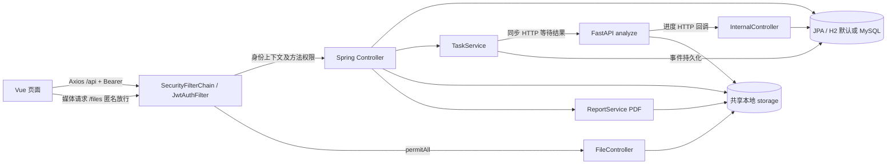
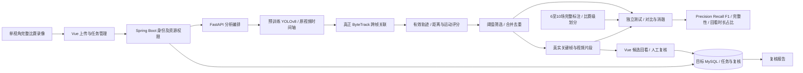
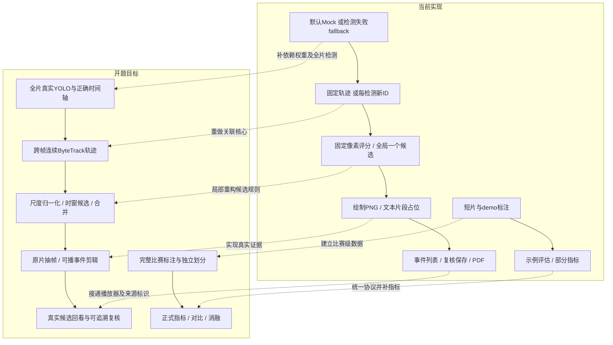

# 02 三端架构与接口数据流

审计时间：2026-10-22。静态源码核对；未启动三端。本文件的 Java 路径省略共同前缀 `backend/src/main/java/com/footballref/assist/`。逐行底稿见 [backend-numbered.txt](evidence/backend-numbered.txt)。



没有消息队列、独立任务消费者或分布式文件协议。Java 与 Python 传递绝对文件路径，部署隐含共享文件系统、路径兼容、后端位于 AI 进程 localhost:8080。证据：AiClient.analyze:29，TaskService.runTask:55/68，StorageService:18。前端 client.js:3 使用 /api、:7 注入 token、:15 拼接媒体 URL。

上图表达现有执行关系，不代表所有请求都检查了资源所属人。JWT过滤器先于Controller运行，ADMIN限制在对应方法执行时生效；匿名文件接口也经过安全过滤链，只是被permitAll放行。完整的**页面—组件—事件—API—后端映射**以及组件状态、错误处理见 [frontend-evidence.md](frontend-evidence.md)，其中包含全部12个前端src文件与20组功能调用；不把页面存在等同功能验证。

## 开题目标架构（目标，尚未整体实现）

依据正式开题正文P39、49、53、56、59、62、65、68、73、75，逐项对照见 [06](06-开题报告符合性与重构建议.md)。以下是目标关系，不是当前运行结果。



## 当前流程与目标流程差异



差异证据为detector.py:53–138、tracker.py:115–154、event_rules.py:60–134、analyzer.py:116–138/258–288以及04的数据和指标核对；上图虚线均为后续建议，本轮未开发。

## 全部业务接口

缩写：T=TaskController.toTaskMap:104；E=EventController.toEventMap:93；V=VideoController.toMap；A=AnnotationController.toMap:127；U=UserController.toMap:49；R=EventController.toReviewMap。列表均为数组，默认成功 HTTP 200。下列“登录”仅表示身份门槛，不等于所属资源授权。

|方法 路径|请求 → 响应|权限与调用方|实现|
|---|---|---|---|
|POST /api/auth/login|username,password → token,user(id,username,displayName,role)|匿名；LoginPage:57|AuthController.login:28|
|GET /api/users|无 → U[]|ADMIN；UserPage:35|UserController.list:31|
|POST /api/users|username,password,displayName,role → U|ADMIN；UserPage:40|UserController.create:36|
|GET /api/videos|无 → V[]|登录；按 owner/assignedTo 过滤，ADMIN 全量；VideoAnnotationPage:150|VideoController.list:53|
|POST /api/videos|multipart file,title,competition,teams,matchTime?,assignedToUserId?,sensitivity=BALANCED → {video:V,task:T}|登录；WorkbenchPage:132|VideoController.upload:62|
|GET /api/tasks|无 → T[]|登录；owner/assignedTo/ADMIN；WorkbenchPage:142|TaskController.list:48|
|GET /api/tasks/{id}|id → T + events:E[]|登录，无所属检查；WorkbenchPage:148|TaskController.detail:59|
|POST /api/tasks/{id}/cancel|id → T|登录，无所属检查；WorkbenchPage:164|TaskController.cancel:67|
|POST /api/tasks/{id}/retry|id → T|登录，无所属检查；WorkbenchPage:169|TaskController.retry:73|
|DELETE /api/tasks/{id}|id → deleted|登录，无所属检查；未发现前端调用|TaskController.delete:80|
|GET /api/tasks/{id}/events|id → E[]|登录，无所属检查；未发现前端调用|TaskController.events:88|
|GET /api/tasks/{id}/report|id → PDF|登录，无所属检查；WorkbenchPage:176|TaskController.report:94|
|GET /api/events/{id}|id → E + reviews:R[]|登录，无所属检查；未发现前端调用|EventController.detail:44|
|POST /api/events/{id}/review|result,reasonCode,note? → R|登录，无所属检查；EventDetail:170|EventController.review:52|
|PATCH /api/events/{id}/tracks|involvedTrackIds → E|登录，无所属检查；未发现前端调用|EventController.updateTracks:66|
|POST /api/events/manual|taskId,eventType,timestampMs,summary,involvedTrackIds → E|登录，无所属检查；ManualEventForm:45|EventController.manual:73|
|GET /api/annotations|无 → A[]|ADMIN；AnnotationPage:56|AnnotationController.list:61|
|POST /api/annotations|title,source → A|ADMIN；AnnotationPage:61、VideoAnnotationPage:277|AnnotationController.create:66|
|POST /api/annotations/{id}/labels|multipart file(JSON) → A|ADMIN；AnnotationPage:74、VideoAnnotationPage:288|AnnotationController.uploadLabels:75|
|GET /api/annotations/{id}/labels|id → JSON附件|ADMIN；AnnotationPage:87|AnnotationController.downloadLabels:93|
|GET /api/annotations/{id}/labels.csv|id → CSV附件|ADMIN；AnnotationPage:87|AnnotationController.downloadLabelsCsv:103|
|DELETE /api/annotations/{id}|id → deleted,id|ADMIN；AnnotationPage:121|AnnotationController.delete:114|
|GET /api/files|path → 文件流|匿名；client.fileUrl:15、图片/视频元素|FileController.file:30|
|POST /api/internal/tasks/{id}/progress|stage,progressPercent,message → ok|X-Internal-Token；Python _progress:303|InternalController.progress:25|
|GET AI /health|无 → status,service,analyzerMode,yoloModel,trackerMode,poseMode|无鉴权；健康检查|ai-service/app/main.py:17|
|POST AI /internal/analyze|taskId,videoPath,outputDir,sensitivity,enabledEvents,callbackUrl?,internalToken? → AnalysisResult|无鉴权；AiClient.analyze:29|main.py:32|
|POST AI /internal/tasks/{id}/cancel|id → taskId,status|无鉴权；AiClient.cancel:42|main.py:43|

FastAPI 另有默认 /docs、/redoc、/openapi.json 框架端点（未显式禁用）。AnalysisResult 字段为 taskId,status,stage,progressPercent,resultJsonPath,events,metrics,errorMessage；事件携带 externalId,eventType,riskLevel,timestampMs,windowStartMs,windowEndMs,involvedTrackIds,summary,evidenceMetrics,trackBoxes,keyframePath,clipPath,confidence，定义于 schemas.py:53–81。Java 将 evidenceMetrics/trackBoxes 再编码为 JSON 字符串，事件 DTO 的 involvedTrackIds 变为逗号字符串，客户端需解析。

响应字段完整定义按下述表及底稿 toMap 方法核对：T 为 id,videoId,videoTitle,status,stage,progressPercent,sensitivity,outputDir,resultJsonPath,errorMessage,createdAt,updatedAt；E 为实体字段去掉 task 加 taskId；R 去掉 event/reviewer 对象改 eventId/reviewer显示名；V 去掉 owner/assignedTo 对象改显示名；U 不含 passwordHash；A 将 createdBy 改显示名。实体不直接返回，不会通过这些 DTO 直接暴露 passwordHash。

## 数据模型、索引和迁移

所有实体 id 均 Long + IDENTITY；createdAt 均 Instant、非空不可更新。下面的括号为字符串最大长度，? 为可空；默认字符串没有索引。字段、注解与精确行号由附录自动逐项提取，避免把逻辑模型当成实库结构。

|实体|全部其他字段|关系|
|---|---|---|
|UserAccount|username(64,unique),passwordHash(128),role(16),displayName(80),enabled=true|无|
|VideoAsset|title(160),competition(120),teams(160),matchTime? LocalDateTime,originalPath(600)|owner→User 必填；assignedTo→User 可空|
|AnalysisTask|status(24)=PENDING,sensitivity(32)=BALANCED,stage(80)=PENDING,progressPercent int=0,outputDir?(600),resultJsonPath?(600),errorMessage?(1200),updatedAt Instant|video→Video 必填|
|DisputeEvent|externalId(80),eventType(24),riskLevel(24),timestampMs/windowStartMs/windowEndMs long,summary(500),confidence double,keyframePath(600),clipPath(600),involvedTrackIds(200),evidenceJson? LOB,trackBoxesJson? LOB|task→Task 必填|
|ReviewRecord|result(24),reasonCode(120),note?(1000),revision int|event→Event、reviewer→User 必填|
|AnnotationTask|title(160),source(300),status(40)=REGISTERED,labelFilePath?(600),sampleCount/eventCount int=0,eventTypeSummary?/splitSummary?(300)=""|createdBy→User 必填|

各 ManyToOne 默认 EAGER，未声明级联删除；未声明 @Version、额外 @Index、event/revision 联合唯一或 task/externalId 联合唯一。JPA 会映射关系外键，但未查询实际数据库确认约束和名称。仓库均 JpaRepository，事件按 timestamp 排序，复核按 revision 倒序；列表无分页。默认 H2 文件库、MySQL profile 都 ddl-auto:update；SchemaMigrator.run:25 只补 annotation_task 的四个统计列，无版本化迁移历史。冲突处优先建议保留版本化迁移作为将来唯一 schema 来源，现有自动 update 与补列器应迁移后废弃，不在本次混合改写。

## 上传到报告的真实链路

VideoController.upload 先落盘，再保存 Video，再 createTask 提交后外部调用 @Async runTask。后者整个方法 @Transactional，调用 AI HTTP 等待完成再删除旧事件、逐条保存、标成功。AI 回调单独事务更新进度，取消亦单独事务写 CANCEL_REQUESTED。分析事务的一级缓存/锁可能使它读不到新取消状态，甚至覆盖回调；这是明确待运行复现的并发风险，不能声称实测死锁。retry 在同一类调用 runTask，绕过异步代理，HTTP 请求可能等待整个分析；没有终态限制及 attemptId。任务状态枚举存在，但没有统一合法转移表、幂等键、恢复扫描或持久化队列。Python 取消集只在单进程内存，进入 analyze 会 discard 同 taskId 的取消请求，多 worker 与重启不可靠。

事件复核追加 ReviewRecord，revision=count+1；报告即时查询最新版本并写固定 referee-review-report.pdf。标注独立存 JSON，并未自动流入训练或分析。人工补录 keyframePath 和 clipPath 都为原视频路径，不能视为真实关键帧/剪辑实现。

检查点：接口、DTO、关系及任务链路已静态核对；尚未运行权限、异步和并发复现。工程风险见 05。

### AnalysisTask.java 字段注解证据
```text
9: @Entity
11:     @Id
12:     @GeneratedValue(strategy = GenerationType.IDENTITY)
13:     private Long id;
15:     @ManyToOne(optional = false)
16:     private VideoAsset video;
18:     @Enumerated(EnumType.STRING)
19:     @Column(nullable = false, length = 24)
20:     private TaskStatus status = TaskStatus.PENDING;
22:     @Enumerated(EnumType.STRING)
23:     @Column(nullable = false, length = 32)
24:     private Sensitivity sensitivity = Sensitivity.BALANCED;
26:     @Column(nullable = false, length = 80)
27:     private String stage = "PENDING";
29:     @Column(nullable = false)
30:     private int progressPercent = 0;
32:     @Column(length = 600)
33:     private String outputDir;
35:     @Column(length = 600)
36:     private String resultJsonPath;
38:     @Column(length = 1200)
39:     private String errorMessage;
41:     @Column(nullable = false, updatable = false)
42:     private Instant createdAt = Instant.now();
44:     @Column(nullable = false)
45:     private Instant updatedAt = Instant.now();
47:     @PreUpdate
```

### AnnotationTask.java 字段注解证据
```text
7: @Entity
9:     @Id
10:     @GeneratedValue(strategy = GenerationType.IDENTITY)
11:     private Long id;
13:     @Column(nullable = false, length = 160)
14:     private String title;
16:     @Column(nullable = false, length = 300)
17:     private String source;
19:     @Column(nullable = false, length = 40)
20:     private String status = "REGISTERED";
22:     @Column(length = 600)
23:     private String labelFilePath;
25:     @Column(nullable = false)
26:     private int sampleCount = 0;
28:     @Column(nullable = false)
29:     private int eventCount = 0;
31:     @Column(length = 300)
32:     private String eventTypeSummary = "";
34:     @Column(length = 300)
35:     private String splitSummary = "";
37:     @ManyToOne(optional = false)
38:     private UserAccount createdBy;
40:     @Column(nullable = false, updatable = false)
41:     private Instant createdAt = Instant.now();
```

### DisputeEvent.java 字段注解证据
```text
9: @Entity
11:     @Id
12:     @GeneratedValue(strategy = GenerationType.IDENTITY)
13:     private Long id;
15:     @ManyToOne(optional = false)
16:     private AnalysisTask task;
18:     @Column(nullable = false, length = 80)
19:     private String externalId;
21:     @Enumerated(EnumType.STRING)
22:     @Column(nullable = false, length = 24)
23:     private EventType eventType;
25:     @Enumerated(EnumType.STRING)
26:     @Column(nullable = false, length = 24)
27:     private RiskLevel riskLevel;
29:     @Column(nullable = false)
30:     private long timestampMs;
32:     @Column(nullable = false)
33:     private long windowStartMs;
35:     @Column(nullable = false)
36:     private long windowEndMs;
38:     @Column(nullable = false, length = 500)
39:     private String summary;
41:     @Column(nullable = false)
42:     private double confidence;
44:     @Column(nullable = false, length = 600)
45:     private String keyframePath;
47:     @Column(nullable = false, length = 600)
48:     private String clipPath;
50:     @Column(nullable = false, length = 200)
51:     private String involvedTrackIds;
53:     @Lob
54:     private String evidenceJson;
56:     @Lob
57:     private String trackBoxesJson;
59:     @Column(nullable = false, updatable = false)
60:     private Instant createdAt = Instant.now();
```

### ReviewRecord.java 字段注解证据
```text
8: @Entity
10:     @Id
11:     @GeneratedValue(strategy = GenerationType.IDENTITY)
12:     private Long id;
14:     @ManyToOne(optional = false)
15:     private DisputeEvent event;
17:     @ManyToOne(optional = false)
18:     private UserAccount reviewer;
20:     @Enumerated(EnumType.STRING)
21:     @Column(nullable = false, length = 24)
22:     private ReviewResult result;
24:     @Column(nullable = false, length = 120)
25:     private String reasonCode;
27:     @Column(length = 1000)
28:     private String note;
30:     @Column(nullable = false)
31:     private int revision;
33:     @Column(nullable = false, updatable = false)
34:     private Instant createdAt = Instant.now();
```

### UserAccount.java 字段注解证据
```text
8: @Entity
10:     @Id
11:     @GeneratedValue(strategy = GenerationType.IDENTITY)
12:     private Long id;
14:     @Column(nullable = false, unique = true, length = 64)
15:     private String username;
17:     @Column(nullable = false, length = 128)
18:     private String passwordHash;
20:     @Enumerated(EnumType.STRING)
21:     @Column(nullable = false, length = 16)
22:     private Role role;
24:     @Column(nullable = false, length = 80)
25:     private String displayName;
27:     @Column(nullable = false)
28:     private boolean enabled = true;
30:     @Column(nullable = false, updatable = false)
31:     private Instant createdAt = Instant.now();
```

### VideoAsset.java 字段注解证据
```text
8: @Entity
10:     @Id
11:     @GeneratedValue(strategy = GenerationType.IDENTITY)
12:     private Long id;
14:     @Column(nullable = false, length = 160)
15:     private String title;
17:     @Column(nullable = false, length = 120)
18:     private String competition;
20:     @Column(nullable = false, length = 160)
21:     private String teams;
23:     private LocalDateTime matchTime;
25:     @Column(nullable = false, length = 600)
26:     private String originalPath;
28:     @ManyToOne(optional = false)
29:     private UserAccount owner;
31:     @ManyToOne
32:     private UserAccount assignedTo;
34:     @Column(nullable = false, updatable = false)
35:     private Instant createdAt = Instant.now();
```

