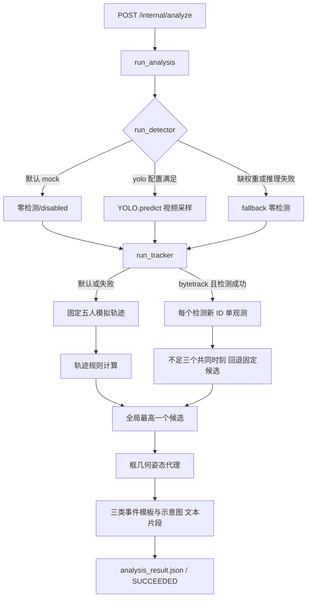

# AI 算法深度审计

日期：2026-10-22。以下行号相对项目根目录；审查覆盖 app 的七个 Python 文件及唯一测试文件。源码未修改；算法运行仅执行临时目录内的现有契约测试。状态严格采用指定七类，模块内部的 completed 等只是程序字段，不能直接等同研究完成。

## 1. 总体判断与真实调用链

**真实 ByteTrack 未实现；现有主流程是可运行的演示契约。YOLO 有实际调用代码，但当前环境和权重条件不具备；即使检测成功，后续跟踪仍无法形成连续轨迹。**

|环节|入口与证据|统一状态|验证边界|
|---|---|---|---|
|请求与输出契约|main.py:31–39；schemas.py:29–81|已实现且验证|直接调用契约测试，未启动 HTTP 集成验收|
|真实检测调用|detector.py:53–138|已实现但未验证|无真实推理成功记录|
|ByteTrack 算法|tracker.py:115–154|未实现|存在格式适配器，未有跨帧关联|
|距离及运动评分|event_rules.py:60–134|部分实现|模拟轨迹可计算，真实轨迹未接通|
|候选合并、去重、阈值筛选|event_rules.py:51–57、77；analyzer.py:103–157|未实现|每对取一个最小距离时刻，随后只选一个全局候选|
|姿态模型|pose.py:98–151、258–274|Mock或占位|几何代理和合成关键点|
|手球、越位|analyzer.py:103–106、227–242|Mock或占位|固定时间、ID与分值公式|
|事件原视频抽帧、剪辑|analyzer.py:116–138、245–288|Mock或占位|PNG绘图与 txt 文件|
|全场比赛有效分析|detector.py:57–58、95–97；tracker.py:129–154|未实现|默认最多12个采样帧且无连续轨迹|

本表未注明路径前缀的源码均位于 `ai-service/app/`。

## 2. YOLO：真正写了什么

`run_analysis`（analyzer.py:56–58）将上传文件路径传给 `run_detector`。默认 `AI_ANALYZER_MODE=mock` 不打开视频，返回 disabled。设置为 yolo 后，检查输入文件存在、模型路径和依赖，再实例化 `YOLO(model_ref)`（detector.py:61–94）。默认模型 `models/yolo/yolov8n.pt` 相对进程工作目录；仅裸 `.pt` 文件名加 `AI_YOLO_ALLOW_DOWNLOAD=true` 允许下载分支。本次没有下载。

`model.predict(source=video_path, stream=True, vid_stride=15, conf=0.25)` 是真实视频推理调用。上限默认12帧；项目未显式裁切、设图像尺寸、NMS IoU或 device，这些交给库默认行为，不能据此确认 GPU。类别在推理后按标签过滤，默认 `person,sports ball`；person 不区分裁判/球员。检测 JSON 保存 classId、label、confidence、xyxy、sampleIndex、推算 frameIndex；**没有原视频 FPS、PTS或 timestampMs**（99–106、141–161）。首个预测帧可通过 `result.plot()` 保存真实检测预览（109–112），这与事件 keyframe.png 是不同产物。

缺文件、缺权重、缺依赖、推理异常均返回 fallback（61–75、113–114、192–203），下游继续成功。检测 fps 是 `样本数/包含模型加载的耗时`，不是视频源帧率（116、134）。mAP50/precision/recall 被写为常量0（analyzer.py:176–178），不代表测得零精度。

本轮主审计环境检查：项目未找到所需权重；`.venv/Scripts/python.exe -B` 的模块发现结果为 ultralytics=false、cv2=false、fastapi=true。历史结果以 `evidence/analysis-results.json` 重查为准，不能把 mode=yolo 当作完成推理；其 status 仍可能为 fallback。当前真实推理 **无法运行**；安装依赖和放置权重后仍须单独验证。

## 3. Tracker：不是 ByteTrack

`TrackingRun` 保存 tracks 字典，每个 `TrackState` 含 track_id、label、team、observations；观测含 timestamp_ms、frame_index、box、confidence（tracker.py:21–50）。契约可复用。

默认 `_mock_tracks` 生成固定 ID 7、12、9、11、3 的9个时间点，坐标按算术递推并为7/12加入接触偏移（204–234）。这解释了为何规则能得到连续轨迹，但与上传视频无关。

bytetrack 分支要求检测完成，再进入 `_write_detection_seeded_tracks`。其循环为每个 person 检测执行 `track_id=next_track_id; next_track_id+=1`，创建只有一个 observation 的新轨迹（129–150）。没有调用跟踪库，没有 Kalman 状态、IoU匹配、高低置信度两阶段关联、丢失恢复或遮挡处理；confidence 仅复制，未参与关联。返回状态主动标为 adapter_pending（153–154）。因此规则的三共同观测门槛（event_rules.py:69–71）必然无法满足。

时间戳直接 `frameIndex*40`，隐含25 FPS（tracker.py:132），无法适配其他帧率/VFR。IDF1及ID切换均写常量0（194–195）。`track_boxes_for` 找最近观测且无时间距离上限；缺 ID 时造框和队伍标签（85–112），不可作为真实证据。

## 4. 接触评分的精确公式

来源：event_rules.py:60–134、137–214。对所有不同轨迹成对；仅已知同队时剔除，也可由 `AI_FOUL_TRACK_PAIRS` 指定。以完全相同 timestamp_ms 连接两条轨迹，排序，少于3对观测跳过。无插值、最大缺帧间隔、轨迹置信度门槛或 ID切换修复。

框中心 `c=(x1+x2,y1+y2)/2`，单位像素；`d_t=||c_i(t)-c_j(t)||₂`。在一对轨迹的**全部共同时刻**选 `k=argmin d_t`。令 `clip(x)=max(0,min(1,x))`：

- 接近分量 `P=clip(1-d_k/140)`；140为 `AI_FOUL_DISTANCE_THRESHOLD_PX` 默认值。这是固定像素阈值缩放，**不是以框高、球员尺度或球场坐标归一化距离**。
- `Δt=max(0.001,(t_k-t_{k-1})/1000)` 秒；`closing=max(0,(d_{k-1}-d_k)/Δt)` px/s；`C=clip(closing/40)`。若 k=0，closing=0。
- `v_i=(c_i(t)-c_i(t-1))/Δt`，`u=v_i-v_j`；`velocity_delta=||u_after-u_before||₂`，单位 px/s，**不是加速度**；`V=clip(velocity_delta/30)`。k在序列边界时为0。
- `W=clip((P+C)/2)`；`S=round(clip(0.52P+0.33V+0.15W),3)`，等价有效权重 `0.595P+0.33V+0.075C`。W没有衡量持续接触时间。
- 候选 confidence=S；仅保留全局最高分，不执行分数门槛。每对最多一个候选，全流程最多一个 FOUL；没有同一对多次接触、时间非极大抑制或重叠片段合并。

阈值140/40/30可由环境变量改，权重写死。时间除法有0.001保护；阈值未限制正数/有限数，设0会直接除零（78–82、309–313）。异常会传至 main.py:38–39 返回500。未校准透视和镜头运动：两人共同平移可能在相对速度中抵消，但缩放、旋转、透视和检测框变化仍影响距离/速度；不能换算 m/s。

规则真被主流程调用（analyzer.py:69），但“有公式”“可输入真实结构”“真实运动含义”“经过真实比赛验证”是四个层次：目前第一层成立，第二层受 Tracker 阻断，后两层未验证。没有可用候选时生成7/12号、12.4秒、0.67分固定候选（event_rules.py:217–237），不会输出正常的空候选集。

输出窗口固定前后3秒，仅起点截断到0，终点未限制视频时长。灵敏度1.15/1/0.82仅乘输出分数，不能控制候选召回数量（analyzer.py:97–101、128）。姿态融合 `max(S,0.88S+0.12pose_score)`，上限0.96；风险阈值0.78/0.58/0.38（126–131、291–300）。confidence 是启发式分数，未经概率校准，不能解释成犯规概率。

## 5. 姿态和证据

pose.py:98–113 用两框交叠、中心距离推导特征；`overlap=交集面积/较小框面积`（246–255），`limb=clip(1-distance/120)`，`axis=min(45,10+35*overlap)`，`pose_score=clip(0.45*overlap+0.35*limb+0.20*axis/45)`。`cropBox` 是坐标，不执行像素裁剪；`_synthetic_keypoints` 用框比例构造骨架，不来自人体模型。融合会把此代理加入最终分值，建议当前课题冻结该扩展。

事件 `_draw_keyframe` 新建960×540画布、画球场、框、线段（analyzer.py:258–288），没有读原视频。clipPath 指向 `clip_placeholder.txt`（117、134–138），无 FFmpeg/OpenCV 剪辑调用。缺Pillow时写旁路 JSON，却仍返回不存在的 PNG路径（254–256、152）。后端/PDF收到该路径不能改变证据来源；前端即使能播放原视频，也不代表真实片段产物完成。

## 6. 主要问题与改造边界

以下均直接源码证据、置信度高；对毕设影响为核心阻断或结果有效性风险。

|编号/级别|当前行为与可验证影响|位置|建议|
|---|---|---|---|
|AI-01 P0|每检测新ID，运动特征没有真实连续轨迹|tracker.py:129–154|D：保留数据类，重写真实关联核心|
|AI-02 P0|错误回退后仍SUCCEEDED；空场景也可能得到固定事件|detector.py:192–203；event_rules.py:51–54；analyzer.py:75–86|C：真实/演示模式明确隔离，传播来源和失败；允许零候选|
|AI-03 P0|抽帧为画图，片段为文本，证据链未完成|analyzer.py:116–138、258–288|D：按真实时间戳抽帧剪辑并验证文件|
|AI-04 P1|检测默认仅12帧；时间按25FPS推算|detector.py:57–58、95–105；tracker.py:132|C：统一真实时间基准、完整扫描及取消检查|
|AI-05 P1|固定像素尺度、仅全局单候选，无筛选合并|event_rules.py:56、77–85|C：尺度归一化、时窗候选和合并，真实数据调参|
|AI-06 P1|阈值零除/非法数；空检测未形成正常无事件路径|event_rules.py:78–82、309–313|B：配置边界验证及空结果契约|
|AI-07 P1|无鉴权内部API；outputDir/videoPath/callbackUrl直接使用|main.py:31–45；schemas.py:29–39；analyzer.py:45–47、303–321|B：鉴权与路径/回调约束；利用可达性未实测|
|AI-08 P1|进程内取消集；进入请求清除标记，长检测内部无检查|main.py:13、34–35、44；analyzer.py:57–60|C：一致任务状态与可中断计算；多进程行为未运行|
|AI-09 P2|进度回调异常完全吞掉；伪指标固定为0|analyzer.py:176–178、207–209、319–321|B：确定性重试与可见失败，未测量值用缺失语义|
|AI-10 P3|姿态/手球/越位演示输出可被误认真实推理|pose.py:98–113；analyzer.py:103–106、227–242|E：冻结扩展，清晰标注来源|

不需要重写整个 FastAPI 服务。接口字段、JSON契约、检测封装可保留并修复；真实时间、来源、空结果和错误状态宜向后兼容扩展。Tracker及证据生成核心需要重做；规则计算工具可保留，候选生成策略局部重构。清理 mock 应在明确隔离后做，不混合两套来源。

## 7. 运行证据及未核验

执行现有 `ai-service/.venv/Scripts/python.exe -B -m unittest discover -s tests -v`，退出码0，4项通过、0失败、0跳过，用时0.679秒。环境明确设 mock detector/tracker，规则/姿态为默认规则；TEMP/TMP指向审计临时目录。命令与环境见 `evidence/ai-tests-command.json`，完整日志 `evidence/ai-tests.log`。

测试映射：test_contracts.py:40验证默认三事件及JSON文件；70验证缺权重回退；82验证检测失败得到五条模拟轨迹；103验证评分与姿态输出限定于同一候选对。它们保护演示契约，不验证YOLO准确率、跨帧ID、公式数值正确性、真实空事件、帧率、候选召回、证据视频或HTTP鉴权。未运行真实模型/完整比赛/三端联调；未测GPU和外部部署网络可达性。报告中的静态安全推断均不代表已执行漏洞利用。
