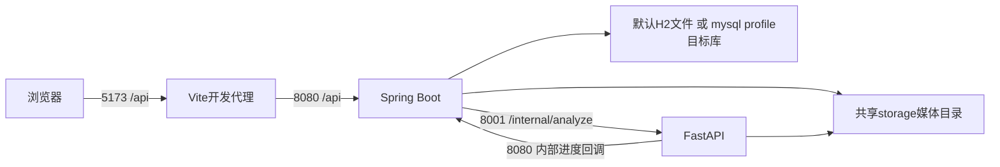

# WBS 00-04 三端启动依赖图

核验日2026-10-24。证据级别：代码静态＝本轮只读文件；现场查询＝本轮明确执行的本机查询；历史日志＝2026-10-22记录；UNVERIFIED＝本轮未证实。没有安装、修改环境变量、启动服务、联网请求、模型加载或配置解密。

## 静态预期拓扑

| 静态准备顺序 | 来源/条件 | 预计命令或动作（本轮未执行） |
|---|---|---|
| 1 本机配置和存储 | 两份YAML、StorageService、P24边界 | 确认工作目录/读写权限/秘密；选择H2或mysql profile；不自动加载草案 |
| 2 可选MySQL | application-mysql.yml；驱动已声明 | 仅mysql模式需准备真正实例/库/账号，当前可用性未验证 |
| 3 AI与后端 | app.main:app、Spring启动主类 | AI在ai-service cwd用现有venv启动；后端在backend cwd用本地工具和已备依赖启动；两者互通后才完整联调 |
| 4 前端 | package.json与vite.config.js | 在frontend cwd依赖已准备后npm run dev；不执行现有含安装动作脚本 |
| 5 真实模式与验收 | 权重、跟踪实现、媒体和合同 | 不以服务启动代替真实算法/媒体成功，当前条件尚不齐备 |

这是建议的静态准备次序，不是已执行顺序。AI先启动可避免后端发任务时不可达；后端必须运行才能接收AI进度回调。开发代理只在Vite开发模式存在，生产同源路由/跨源部署均未验证。

## API与媒体路径

前端baseURL=/api；后端控制器路径/api/...，AI有独立/health、/internal/analyze等路由（完整提取见核验JSON integration.ai.routes）。后端AI地址来自app.ai-service-url。回调在TaskService.java:68硬编码loopback:8080/api/internal/tasks/...，不是从SERVER_PORT自动派生；变更端口或分机部署会出问题。AiClient把回调地址/内部令牌加入请求，AI使用请求的路径与回调数据；不输出令牌值。

后端app.storage-root静态../storage，H2文件../storage/dev-db依赖backend cwd；AI输入/输出路径由后端请求提供，三端并非自动共享远程文件系统。容器/跨机时localhost各指自身，路径权限、代理/CORS和回调可达性需另验。本轮没有新设CORS、发HTTP或识别监听进程。

## 本轮现场运行证据表

| 端口 | 状态 | 证据级别 | 证明界限 |
|---|---|---|---|
| 5173 | 未见监听 | 现场查询 | 未连接或识别进程，未健康检查 |
| 4173 | 未见监听 | 现场查询 | 未连接或识别进程，未健康检查 |
| 8080 | 未见监听 | 现场查询 | 未连接或识别进程，未健康检查 |
| 8001 | 未见监听 | 现场查询 | 未连接或识别进程，未健康检查 |
| 3306 | 监听 | 现场查询 | 未连接或识别进程，未健康检查 |
| 9092 | 未见监听 | 现场查询 | 未连接或识别进程，未健康检查 |

未见监听仅限查询时点和当前网络栈，不证明服务从未启动或不存在其他端口部署。3306监听只说明本机端口存在；H2文件模式不依赖9092监听。HTTP健康、数据库握手、身份鉴定、任务分析、回调和媒体播放均UNVERIFIED。

## 阻断与失败点

- pnpm实际版本/所有解释器/所有外部模型未覆盖；Maven仅静态版本，包缓存完整性未验证
- AI venv缺少Ultralytics、torch、OpenCV、numpy元数据；项目权重库存0、默认两处路径不存在
- 真正ByteTrack关联尚未实现；安装依赖不能替代代码实现
- FFmpeg不在PATH；系统Python附带二进制不代表AI服务可用；FFprobe PATH未找到
- 3306监听身份/项目数据库实例/可连接性均未验证；H2/MySQL真实启动未验证
- 存在明文实例配置与源码演示常量风险，当前只记录键名与范围；DPAPI备份方式未改变
- 现有前端和AI启动脚本含安装动作，当前禁止直接执行；不启动run-system
- CUDA/ML原生依赖可加载性、视频解码、端到端及正式指标未验证

实际启动前的变量名/配置键详见配置边界及纯占位草案。没有把内部地址、存储目录或模型路径当作秘密值向外复制，也没有更改其本地值。本轮到此停止，不开始00-05。
