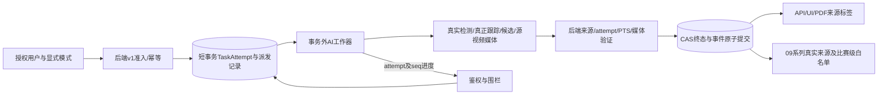

# 兼容迁移与实施拆分

2026-10-24。本文件仅为拟议设计/静态审计，未实施、未部署、未运行合同测试。所有HTTP预期均属于未来v1；现有行为见调用链及差距矩阵。

## 分阶段门控

1. 00-05只确认合同：新增analysisRun命名空间、版本协商、mode和attempt语义。现行接口、schema和文件本轮全不改。旧客户端缺字段只进明确legacy兼容通道，不能默认real；新v1缺必填字段422。兼容期保留旧involvedTrackIds字符串、evidenceJson/trackBoxesJson及现有登录字段。
2. 01-05设计增量Attempt记录，任务加currentAttemptId/stateVersion，事件与复核保留旧ID并新增attempt外键/来源清单关联；初期nullable，再对新v1验证必填，不执行本轮SQL。独立worker/持久派发+短事务替代同类@Async调用，保留旧数据只读。
3. 01-06实现取消/重试/回调序号、围栏、内部鉴权和对账策略；01-07实现统一资源归属、媒体授权和终态提交。进度和技术状态单写入责任，失败不覆写已确认终态。队列/数据库锁细节待实施评审，不能同时混用两套冲突状态权威。
4. 03-05接入显式mode与禁降级；03-03接源PTS与源FPS；04-01真正ByteTrack；06-02真实媒体及来源校验。AI仍以/internal/analyze为适配入口，新v1必须严格验证；向旧响应投影时绝不把mixed来源映成real。新源字段由后端验证保存，当前Map透传不能当校验器。
5. 前端、API、PDF、导出全链标记及09系列准入就绪后，才开放新real正式研究输出。新增QUEUED对旧客户端用兼容状态/阶段投影（PENDING加stage=QUEUED）；旧下载/复核路由保留，旧PDF标来源未知。登录流程不因分析合同改动而改变。
6. 历史记录版本化：legacy_unknown，不回填伪attempt、伪源FPS或real状态；Demo/Smoke显式隔离。人工标注和人工手工事件是独立来源，不视为真实模型预测。旧复核记录不得因retry删旧事件而丢失或自动转挂到新attempt。09系列冻结比赛划分、参数、输入/模型/流水线版本后才能报告正式指标。

## 当前与目标数据流分离

冲突取舍：选显式Real失败而不是现有自动fallback；选真正ByteTrack替换adapter的职责，旧mock只留演示；选源PTS而不是固定25fps。旧方案标历史/legacy，禁止折中成“部分真实即可真实成功”。本轮不删除任何旧代码。

## 范围与兼容回归

保留单视角接触候选、人工最终判断；旧手球/越位页面不删除，不作为真姿态或自动判罚前置。未来需回归登录、上传、任务、复核、PDF、标注及旧来源提示，测试计划不等于已运行。回滚可关闭新v1入口，保留新attempt与旧数据，不回滚抹掉已留存复核；具体DB迁移回滚由实施WBS审查。

完整差距/优先级/用例对应见contract-gap-matrix.csv。
