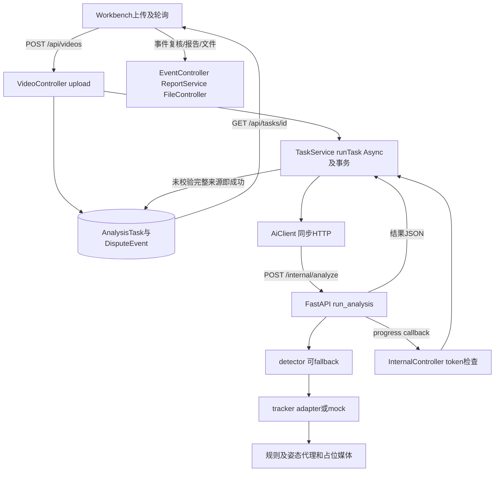

# 当前调用链及字段矩阵

2026-10-24。本文件仅为拟议设计/静态审计，未实施、未部署、未运行合同测试。所有HTTP预期均属于未来v1；现有行为见调用链及差距矩阵。

Java类均位于backend/src/main/java/com/footballref/assist/；前端页面位于frontend/src/pages/，EventDetail在frontend/src/components/；Python schemas位于ai-service/app/schemas.py。下表类名、函数和行号按本轮现行文件。

当前API：VideoController.java:61-92创建上传及任务；TaskController.java:47-101含列表、详情、取消、重试、删除、事件及报告；EventController.java:43-90含详情、复核、track修改、手工事件。WorkbenchPage.vue:119-179消费这些接口，:215起轮询。EventDetail.vue:170提交复核。AnnotationController.java:60-114和AnnotationPage.vue:56-121/VideoAnnotationPage.vue:241-334为独立标注链。客户端frontend/src/api/client.js:1-18使用/api并附身份，文件也经/api/files。

| 字段 | 定义处 | 写入者 | 读取者 | 持久化与展示 | 兼容风险 |
|---|---|---|---|---|---|
| taskId/id | AnalysisTask:13；schemas.AnalysisRequest:30 | VideoController.upload:61-92 | AiClient.analyze:29-39；WorkbenchPage:142-149 | Task表；TaskController.toTaskMap:104-118 | 同一task不是每次尝试 |
| status/stage/progressPercent | AnalysisTask:18-30；schemas.AnalysisResult:73-81 | TaskService.runTask/updateProgress:55-113 | WorkbenchPage:39-57 | Task表→TaskController:109-111→UI/PDF门槛 | status枚举和stage字符串不同；QUEUED现仅stage |
| errorMessage | AnalysisTask:38-39；schemas:81 | TaskService:81-89 | TaskController:115 | Task表→API | 缺结构化错误，可能带本机路径 |
| videoPath/outputDir/resultJsonPath | schemas:31-32,78；AnalysisTask:32-36 | VideoController/StorageService；analyzer.run_analysis:37-87 | AiClient:31-33；TaskService:76 | TaskController:113-114 | API泄露路径风险；拟议媒体ID替代 |
| eventType/riskLevel/confidence | DisputeEvent:21-42；schemas:57-70 | analyzer._build_events:90-157→TaskService.persistEvents:146-153 | EventController.toEventMap:93-110 | Event表→EventDetail.vue:1-43；PDF | 候选强弱不是犯规概率 |
| timestampMs/windowStartMs/windowEndMs | schemas:61-63；DisputeEvent:30-36 | analyzer:145-147→TaskService:149-151 | EventController:100-102；VideoAnnotationPage:202-224 | Event表→UI→ReportService.formatMs:431-433 | 无源PTS；不能用固定25fps补真值 |
| trackIds/trackBoxes/evidenceMetrics | schemas:64-67；DisputeEvent:51-57 | tracker/event_rules→TaskService:156-158 | EventController:107-109；EventDetail | CSV字符串及JSON文本列→PDF:190-274 | 旧involvedTrackIds字符串与AI数组不同，新增字段不改旧形状 |
| keyframePath/clipPath | schemas:68-69；DisputeEvent:45-48 | analyzer:116-138；TaskService:154-155 | EventDetail:4-10；FileController:29-40 | 事件表→匿名文件路由与图片展示 | 文件存在/扩展名不能证明来自原视频 |
| review result/revision | EventController.ReviewRequest:127-128 | EventController.review:51-62 | EventDetail:170；ReportService.latestReview:276-279 | ReviewRecord/ReviewRecordRepository | 迁移必须保留旧event/review引用，不跨attempt重绑 |
| annotation labels/fps | AnnotationController:65-110；VideoAnnotationPage:334 | VideoAnnotationPage:241-288,334 | AnnotationPage:56-121；评估脚本:377-390 | 标注文件路径+AnnotationTask统计 | 标注任务不是分析attempt，历史demo不可自动转真实 |
| executionMode/sourceModel/attemptId/error/videoTimebase | 现行AnalysisTask:9-45与schemas:29-81中缺失 | 拟议后端/AI | 拟议API/UI/PDF/评估 | 现行未持久化；新增方案见草案 | 旧结果必须legacy_unknown，不能据status反推real |

FastAPI main.py:31-45处理/internal/analyze与task级取消；analyzer.py:303-321回调异常被吞掉。TaskService.java:53-91长事务包住AI调用；retry:125同类调用@Async方法，存在代理未生效风险（静态判断，未运行复现）。InternalController.java:23-34只有Token及stage/percent，不校验attempt/回调顺序。FileController.java:29-40有存储root范围检查，但SecurityConfig.java:20匿名许可/api/files/**，不能与任务归属鉴权等同。
