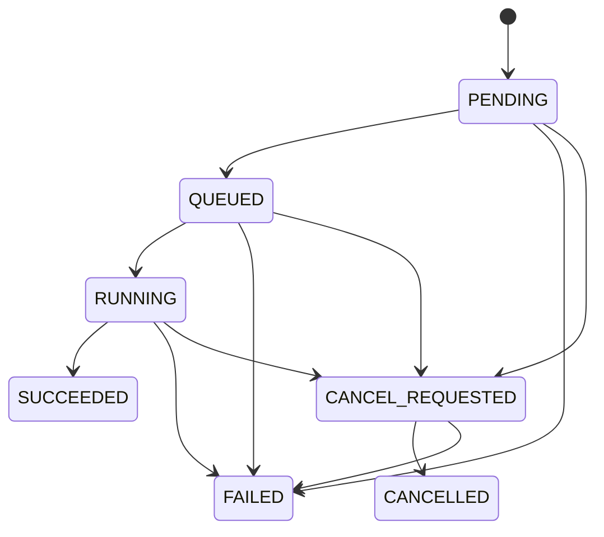
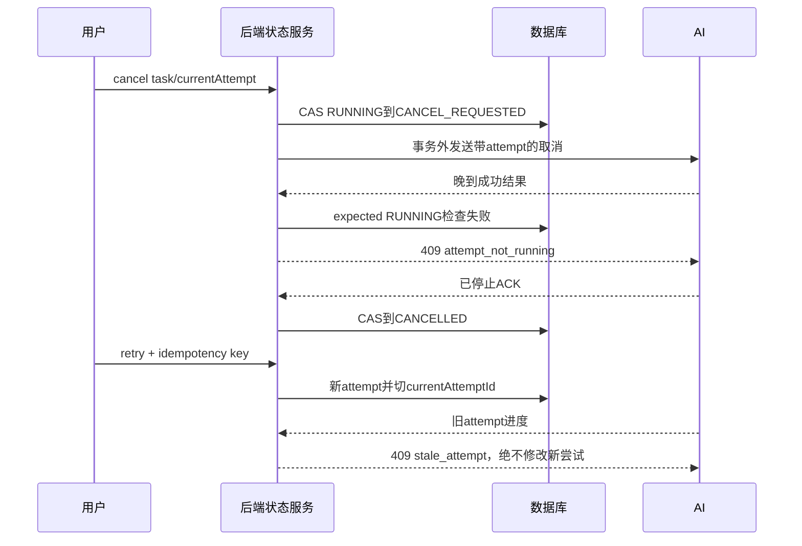

# 状态机与异常时序

2026-10-24。本文件仅为拟议设计/静态审计，未实施、未部署、未运行合同测试。所有HTTP预期均属于未来v1；现有行为见调用链及差距矩阵。

现行TaskStatus.java:3-11为PENDING/RUNNING/CANCEL_REQUESTED/CANCELLED/SUCCEEDED/FAILED。TaskService.java:61-62的QUEUED是stage而非status；拟议新增QUEUED需版本门控，不能谎称已有状态。stage是有序阶段VALIDATING、DETECTING、TRACKING、SCORING、EVIDENCE、FINALIZING，不能代替技术status。

| 触发 | 合法转换 | 唯一写入者 | 幂等/围栏 | 冲突行为 |
|---|---|---|---|---|
| 创建 | 无→PENDING | 后端创建命令 | owner+Idempotency-Key+请求摘要 | 同键同内容返回原任务；异内容409 |
| 持久派发 | PENDING→QUEUED | 后端调度器 | attemptId唯一派发记录+CAS | 重复派发不新建尝试 |
| 工作器认领 | QUEUED→RUNNING | 后端状态服务 | attemptId+lease+version | AI无权直接写DB状态 |
| 进度 | RUNNING→RUNNING | 后端回调处理器 | attemptId+callbackSeq+payload摘要 | 较小seq忽略204；同seq不同体409；百分比不倒退 |
| 正常完成 | RUNNING→SUCCEEDED | 后端结果提交器 | attempt+version+来源/时间/媒体校验 | 包含0候选；无error；提交后不可覆盖 |
| 异常/超时 | PENDING/QUEUED/RUNNING→FAILED | 后端结果/超时管理器 | CAS+结构化错误+围栏 | 迟到成功409，产物隔离不进当前事件 |
| 请求取消 | PENDING/QUEUED/RUNNING→CANCEL_REQUESTED | 后端用户取消命令 | 授权+requestKey+CAS | 成功先提交则取消409；取消先提交则禁止后续成功 |
| 确认取消 | CANCEL_REQUESTED→CANCELLED | 后端确认器 | 停止ACK+attempt+version | 重复取消当前状态200，回调不写终态 |
| 取消无法确认 | CANCEL_REQUESTED→FAILED | 后端超时管理器 | CANCEL_TIMEOUT+围栏 | 不把仅发取消信号当已停止 |
| 重试 | FAILED/CANCELLED→新attempt PENDING | 后端重试命令 | owner+Idempotency-Key；旧attempt不变 | 先旧worker停止或fenced；活动attempt重试409 |
| 删除 | 无活动执行的任务→tombstone | 后端删除命令 | 授权+version；保留审计 | 活动任务409，墓碑回调410；不立即擦除复核来源 |

状态写入集中在一个后端状态服务，不代表所有消息来自同一线程。任务摘要与当前attempt必须同事务CAS更新；非法转换拒绝409/记录审计。结果文件先写attempt私有暂存，验证后以manifest发布并在短事务中写事件+终态，失败则隔离待清理；文件系统与DB不是一笔原子事务，发布失败保留可恢复状态，禁止部分成功。任务完成后人工复核是独立有版本业务，不改算法来源。

同task重复重试用同用户幂等键返回同一新attempt；不同键竞争只有一个CAS成功，其他409。新attempt成功后旧回调无论percent多高均409，不按producedAt排序。相同seq同内容重发204且不重复持久化，低seq204 ignored，不同attempt409，墓碑410。认证失败401优先于资源状态提示。

短事务只包创建/认领/回调状态/最终提交；HTTP、YOLO、剪辑和等待均事务外。现行TaskService.java:53-91及:125存在长事务与同类异步调用风险，具体改造归01-05～01-07，本轮不实现。失败/并发清单和未来断言见合同测试计划T01—T16。
