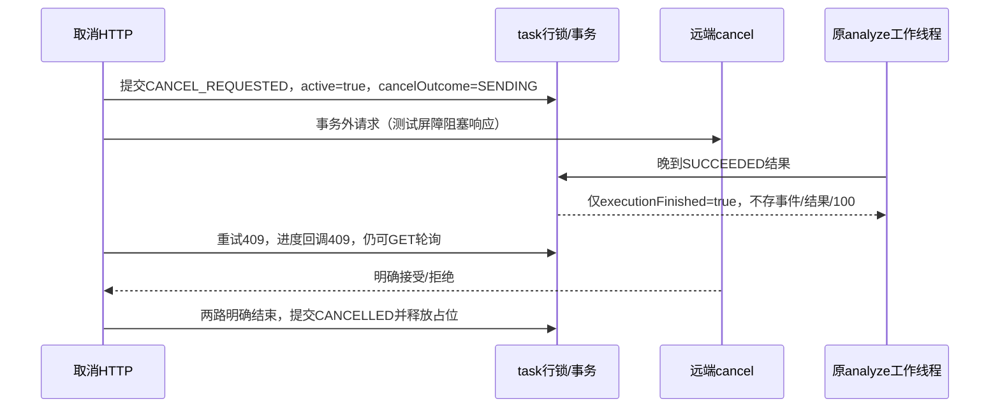

# 取消/完成先后顺序

线性化点是同一AnalysisTask行PESSIMISTIC_WRITE锁下的事务提交；不是controller收到请求、日志打印或远端返回时刻。取消事务提交后才调用AiClient.cancel；原analyze、cancel均由测试断言处于事务外。任何结果/进度更新也先取得同task锁并刷新当前记录。

verified-lifecycle.jsonl中同一task/attempt的三条有序证据为CANCEL_BARRIER_COMMITTED_BEFORE_REMOTE_RESPONSE、LATE_SUCCESS_DISCARDED_CANCEL_HTTP_STILL_PENDING、CANCELLED_AFTER_BOTH_RESPONSES_HISTORY_UNCHANGED：进度均45，事件始终1（原历史事件），resultPathPresent=false；active由true最终变false。历史复核条数与媒体原字节也有断言。

完成先提交的测试先等待DB SUCCEEDED，再请求取消：409，远端cancel调用0，事件1、进度100不变。20混合请求用20线程和统一起跑屏障：10取消202、10重试409；原分析保持未返回，故只有1分析/1远端取消/1活动attempt。与01-05单独的20重试1受理19冲突分开统计。

UNKNOWN：取消超时/断联或分析结果未知时，不据HTTP连接结束推断远端停机；保留active、RECOVERY_REQUIRED，禁止重试。即便测试稍后放行远端响应，该占位也不自动消失。远端cancel为503时原分析仍运行，因此先202+错误CANCEL_REMOTE_REJECTED；原分析明确返回后才本地CANCELLED。

注：本地CANCELLED表示本系统不再接纳该attempt结果，且两个同步I/O调用已明确结束；不保证能抹除远端已计算的文件。新attempt目录隔离历史媒体，远端废弃新文件不在本轮删除。
