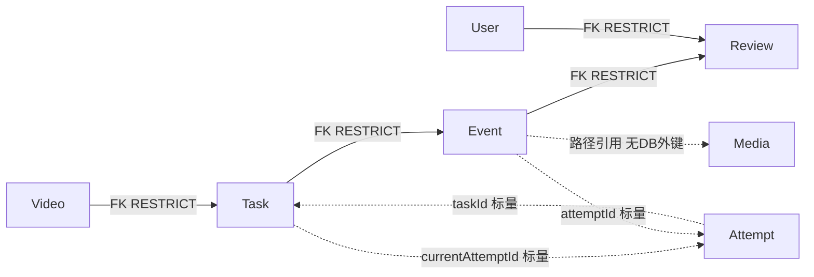

# 实施前调查与决策（2026-10-24）

V2.5 MD/XLSX已逐字节从用户交接包同步，XLSX关键行见plan-verified-rows.json。01-06七份源码及ZIP 53件/52哈希复核一致。本轮基线实际结果见baseline-result.json。私有定向快照见.codex-work/task-01-07-before-full，10份候选文件的存在者均有before SHA；范围保护84份源码。全程禁止真实库、原storage/output和私人媒体操作。

## 实际关系（实体声明 + 合成H2元数据）

before-schema-evidence.json来自独立新内存H2 2.2.224，使用此前验收且源码哈希匹配的编译版本启动回环Spring，JDBC DatabaseMetaData读取真实FK/索引：四条FK的deleteRule=1（importedKeyRestrict），无级联；TaskAttempt只有UUID主键及(taskId,active)非唯一索引。Review没有(event,revision)唯一约束，现有count+save存在并发重复风险。没有把字段名当作FK。

实际调用矩阵：TaskController.DELETE→授权requireTask→events.deleteByTask→tasks.delete（物理删除，复核FK会阻止）；retry→授权→TaskService.schedule同task锁分配；cancel/progress/完成均由TaskService同task锁治理；EventController.review/tracks/manual目前无同task锁；详情/事件列表与ReportService按task取所有事件，混合attempt。MediaAccessService按事件/视频授权，Task归档必须同步阻断事件媒体入口。scripts/reset-demo.ps1具备递归删除合成演示目录的能力，本轮不运行或修改任何清理脚本。

## 选择与取舍

| 方案 | 审计/兼容/恢复 | 决策 |
|---|---|---|
| 物理删除及级联 | 永久丢历史，需真实数据归档决议与回退 | 不采用 |
| 有复核就拒绝删除 | 最小但无法满足有Review也可定义删除语义 | 不采用 |
| 独立迁移归档表 | 保留历史但复制关系和迁移成本高 | 不采用 |
| Task可恢复归档 | 新增nullable archivedAt；删除API200但不物理删除，记录和媒体不变 | 采用 |

不融合物理删除和软删除两套路径。旧TaskController物理删除逻辑本轮替换；DisputeEventRepository底层deleteByTask不再被业务API使用，保留为后续清理候选，不擅删公共Repository方法。

归档/恢复、review/tracks/manual在同task锁内再次鉴权。活动或结果未知attempt归档409，不解除active；归档后的读取、媒体、报告、重试/取消/回调拒绝，恢复仅清archivedAt，不改状态、归属或安全占位。已授权且先完成选择的导出可继续交付其快照，不承诺撤回已发送字节。原始视频仍属于独立Video资源，归档Task不删除Video或改变其授权。

默认事件/PDF仅currentAttemptId；无current的旧任务仅LEGACY null引用。scope=all保留全部可见历史，scope=legacy只null，attemptId必须属于同task，非法关联fail-closed。手动事件绑定创建时currentAttemptId。无法确定旧归属保持null/UNKNOWN，绝不根据时间或媒体名猜测回填。保持现有FK限制，不给标量补危险级联。

## 精确白名单与意图用例

AnalysisTask（归档字段）；ResourceAccessService（归档读隔离）；TaskService.locked（归档写隔离）；TaskController（归档/恢复与查询/导出语义）；EventController（写操作共锁/手动归属）；ReportService（按传入选择导出、内存PDF避免旧文件覆盖）；TaskHistoryService新增（单一锁/选择/生命周期）；WorkbenchPage.vue（历史选择、归档/恢复最小操作）；ResourceAuthorizationTest（删除改归档的必要断言）；TaskHistoryTest新增（历史、FK、20并发、事务/媒体错误与恢复）。其他源码禁止改动。

不清文件；媒体恢复测试只在专用合成目录复制/恢复一个测试文件并比对哈希。Schema仅增加archived_at，H2新库/旧记录动态验证，MySQL只给review-only脚本。对无法无歧义匹配attempt的历史只做标识；没有真实数据永久删除或归档合规决议，不需要也不执行此类决策。
